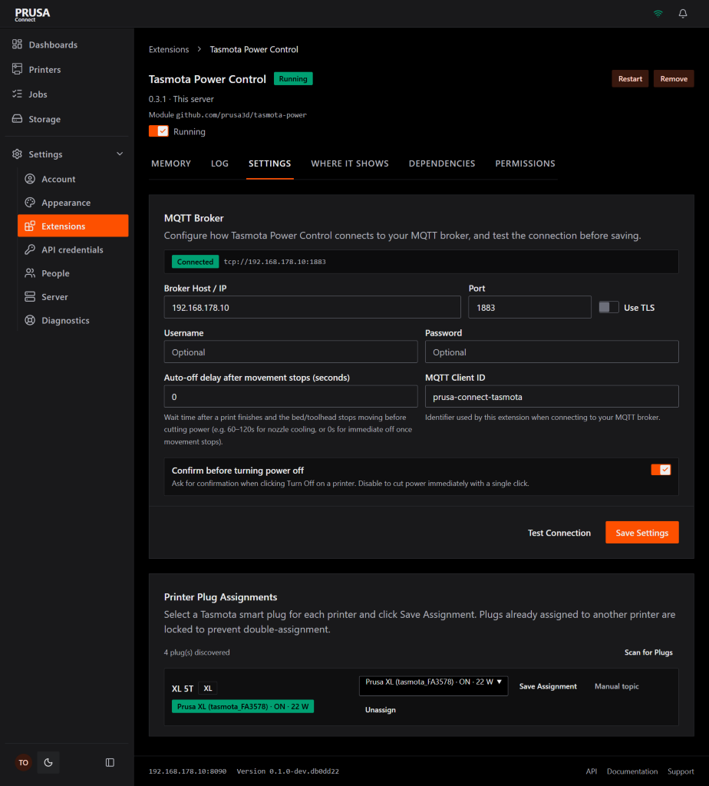
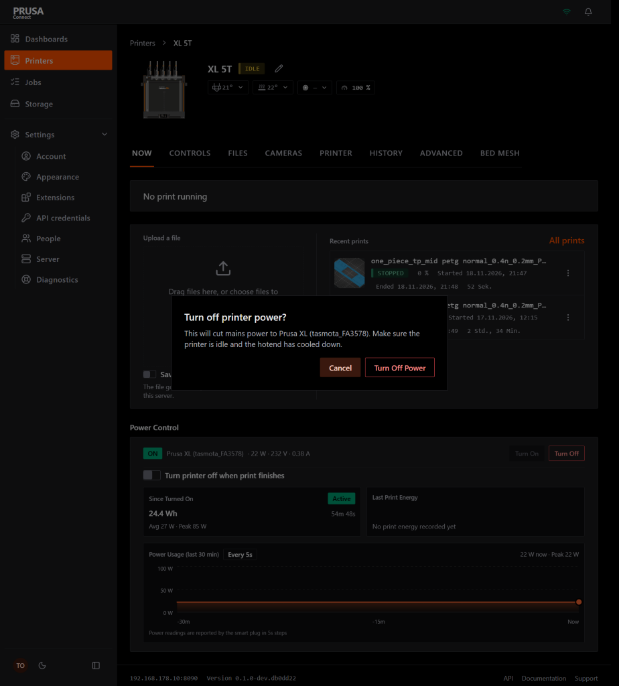
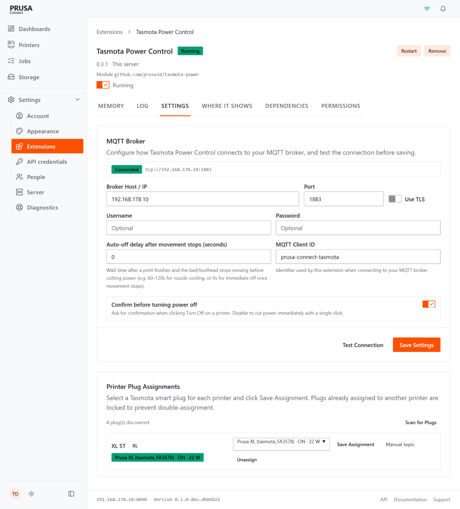
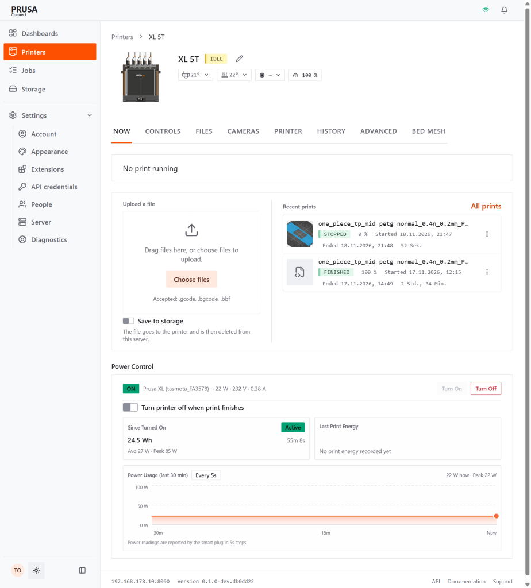
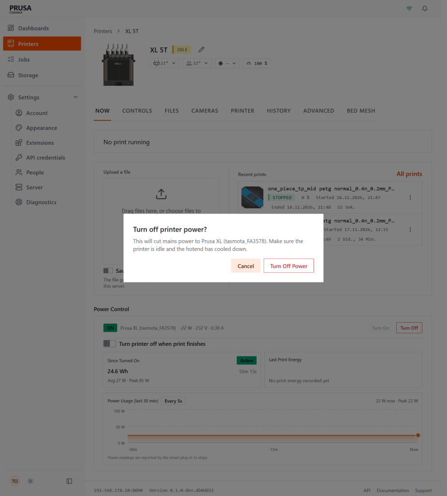

# Tasmota Power Control (`connect-power-control`)


Controls and monitors Tasmota smart plugs for printers inside Prusa Connect Local via an external MQTT broker, the optional built-in MQTT 3.1.1 broker, or per-printer Direct HTTP (`/cm`) without a broker.

## Screenshots

### Dark Mode

| Settings & Plug Assignments | Printer Power Control & Live Graph |
|---|---|
|  |  |

| Turn-Off Confirmation Dialog |
|---|
|  |

<details>
<summary>Light Mode Screenshots</summary>

| Settings & Plug Assignments | Printer Power Control & Live Graph |
|---|---|
|  |  |

| Turn-Off Confirmation Dialog |
|---|
|  |

</details>

## Features

- **Three Connection Options**:
  - **External MQTT Broker**: Connect to Mosquitto or an existing LAN/TLS broker with credentials and live connection testing.
  - **Optional Built-in MQTT Broker (Port 1883)**: Run a lightweight embedded MQTT 3.1/3.1.1 broker inside the extension, with automatic conflict detection if another MQTT broker is already on the network or Docker `-p 1883:1883` is missing.
  - **Direct HTTP (IP) per Printer**: Connect directly to a Tasmota plug's IP over HTTP (`/cm?cmnd=Status 0` & `POWER<n>`) with optional Web Password and zero MQTT setup.
- **Auto-Discovery & Multi-Relay Support (`POWER1`–`POWER8`)**: Discovers Tasmota plugs via `tasmota/discovery/+/config` (with fallback manual topic input) and prevents assigning the same plug/relay to two printers.
- **Broad Tasmota Compatibility**: Handles `SetOption4 1`, `SetOption26 1`, `SetOption90 1`, custom `StateText1..4`, custom `FullTopic` / `Prefix1..3`, empty `PowerRetain 0` clear payloads, `Status 8`/`10`/`11`, stale `LWT` protection, and verified switching.
- **Active-Print & Axis Motion Safety Interlock**: Blocks power-off while printing, paused, busy, or while printer axes (`/axis/x`, `/axis/y`, `/axis/z`) are moving.
- **Auto-Off After Print & Configurable Turn-Off Confirmation**: Optional one-shot auto-off cooldown after motion stops, plus optional confirmation dialog on manual Turn Off.
- **Live Power Graph & Energy Tracking**: 5-second active polling, 30-minute rolling wattage graph, current/last turn-on session totals (`Wh`/`kWh`, duration, average/peak `W`), and per-print file energy history.

## Building & Testing

```sh
make check    # clones core at CORE_REF into .core/, vets & tests Go, type-checks & builds UI
make release  # builds all platforms declared in module.yaml into release/
```

## Docker Note for Built-in MQTT Broker

If Prusa Connect runs inside a bridge-networked Docker container and you enable **Run built-in MQTT broker**, publish TCP port `1883` (`-p 1883:1883`) on the container so smart plugs on your LAN can connect to it. **Direct HTTP (IP)** requires no inbound container ports.
