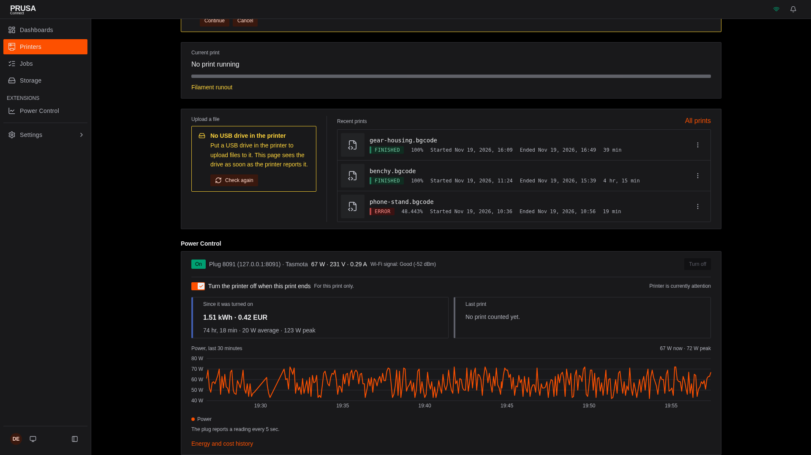
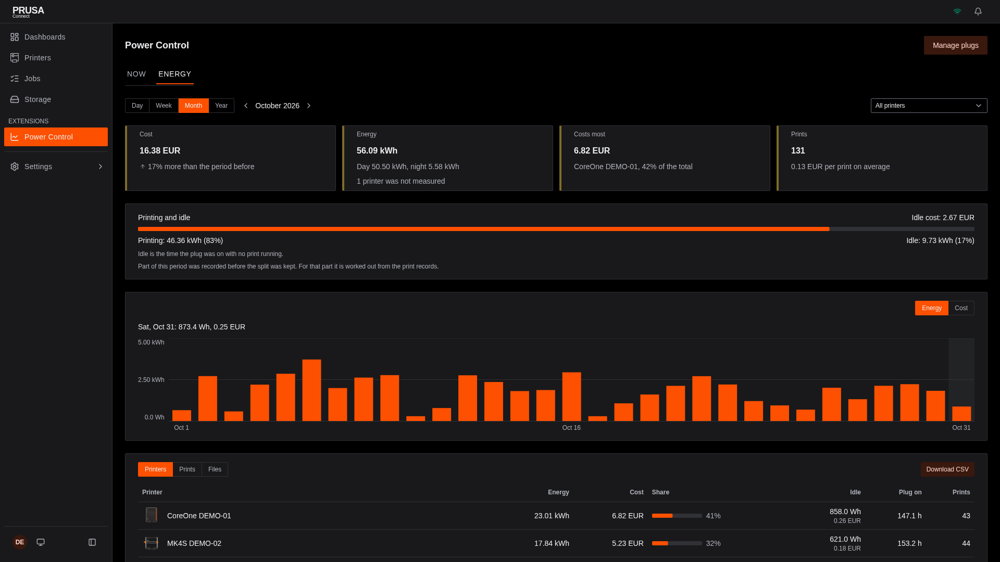
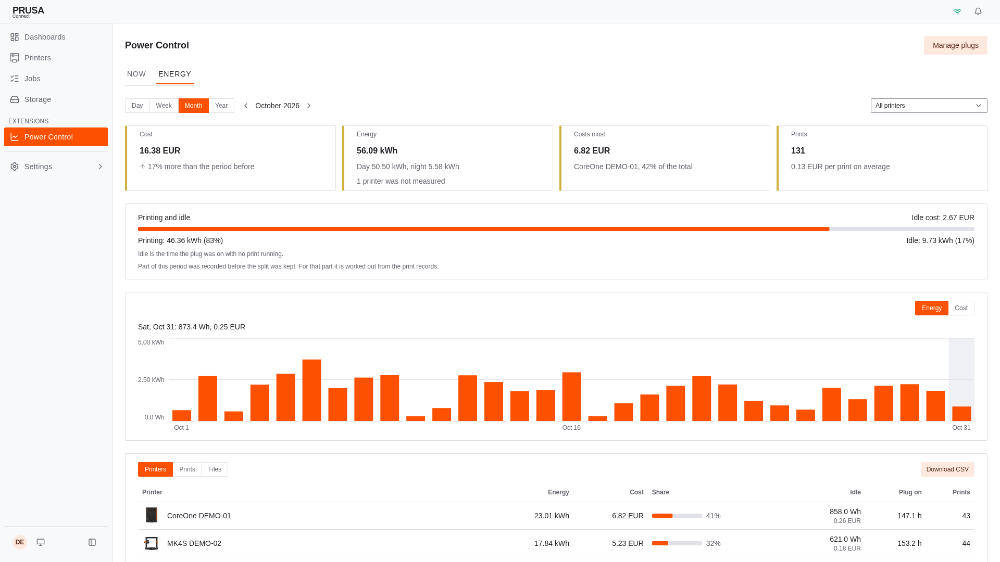

# Connect Power Control (`connect-power-control`)


Switches and monitors the smart plug of each printer inside Prusa Connect Local: Tasmota, Shelly, Zigbee2MQTT, ESPHome, OpenBeken, any other MQTT plug, and any switch Home Assistant controls. A plug is reached through an MQTT broker, directly by its IP address, or through Home Assistant.

## Screenshots

### Dark Mode

| The Plugs tab | A printer's Power Control section |
|---|---|
|  |  |

| The Power Control page, asking before it turns a printer off |
|---|
|  |

| The Energy tab of the Power Control page |
|---|
|  |

<details>
<summary>Light Mode Screenshots</summary>

| The Plugs tab | A printer's Power Control section |
|---|---|
|  |  |

| The Power Control page, asking before it turns a printer off |
|---|
|  |

| The Energy tab of the Power Control page |
|---|
|  |

</details>

## Features

- **Ten plug drivers in one extension**: Tasmota (MQTT or by IP address), Shelly Gen1 and Gen2+ (MQTT or by IP address), Zigbee2MQTT, ESPHome, OpenBeken, custom MQTT topics, and Home Assistant for Kasa, Tapo, Tuya, Matter and the rest.
- **Guided setup**: pick the plug, pick how Connect reaches it, fill in only what that plug needs. Plugs the broker finds and Home Assistant entities are picked from a list. The dialog says whether the plug answered.
- **Three ways to connect**:
  - **Your own MQTT broker**, with TLS, credentials and a connection test.
  - **The built-in MQTT broker** (TCP 1883 by default), for a network with no broker. It listens only on a port you approve, lets in only plugs that sign in with the user name and password you set, and warns when another broker already answers on that address.
  - **Directly by IP address**, with no broker at all.
- **Active-print safety lock**: turning off is refused while the printer prints, is paused or busy, or while its axes still move.
- **Auto-off after a print**: per printer, after a delay you set for all printers or for one. Turning off by hand asks first unless you switch the question off.
- **Auto-off only after a print that finished**: after a cancelled or a failed print the printer stays on, and a paused print never turns it off. A print that is waiting to turn its printer off still does so after a restart of the server.
- **Idle turn-off**: a printer that is on and has not printed or moved for a time you set is turned off. It is off unless you set a time, for all printers or for one. The printer's page counts down and offers **Keep on**.
- **Power Control page**: what the fleet draws now and what that costs per hour, which plugs are on, the energy and cost of today and of this month, and buttons that switch each plug, as a table or as cards. **Turn off idle printers** turns off every printer that is not printing, paused, busy or moving, after asking, and lists the ones it left on.
- **Dashboard card with a power graph**: each printer's power over the last 5 to 60 minutes, over the same spans as the temperature card, and a line with the energy and cost of today and of this month. It needs no setting up, and with one printer it is that printer's card.
- **Power graph and energy figures**: a 30-minute graph on each printer's page, the energy since the plug was turned on and the energy of each print, each with its cost once a price is set.
- **Energy and cost over time**: the energy and the cost of all printers or of one printer over a day, a week, a month or a year, with a chart of energy or cost, the split into printing and idle, a table of the printers, of the prints and of the printed files, and a CSV download. See [Energy and cost](#energy-and-cost).
- **Wi-Fi signal and protection**: a Tasmota or Shelly plug shows how well it hears the Wi-Fi, and says so when it turned itself off because of too much power, heat or a wrong voltage.
- **After a power cut**: the Plugs tab shows what a Tasmota plug, or a Shelly plug read by its address, does when mains power comes back (stays off, turns on, returns to the last state), and warns about a Tasmota plug set to stay on at all times. The setting is only read, never changed.
- **Follows the server's roles**: switching a plug takes the operator role on that printer, and changing plugs and connections takes the manager role. A person sees only the controls they may use.
- **Broad Tasmota compatibility**: multi-relay devices (`POWER1`–`POWER8`), `SetOption4`, `SetOption26`, `SetOption90`, custom `StateText`, custom `FullTopic` and prefixes, stale `LWT` protection, and verified switching.

## Where to find it

| place | what is there |
|---|---|
| Settings, Extensions, Connect Power Control, **Plugs** | a card for every printer with its plug; set up, change, remove |
| the same page, **Connections** | the MQTT broker and Home Assistant |
| the same page, **Automation** | the power-off rules, the idle turn-off, and each printer's auto-off and idle time |
| the same page, **Automation**, **Energy and cost** | how long energy records are kept, the time zone, the currency and the price per kWh |
| **Power Control** in the sidebar, **Now** | the whole fleet at once, as a table or as cards, with today and this month |
| **Power Control** in the sidebar, **Energy** | energy and cost over a day, a week, a month or a year |
| a printer's page, **Power Control** | that printer's plug, graph, energy and cost, and a link to its history on the **Energy** tab |
| a dashboard, the **Printer power** card | the power graph, with today and this month, beside the other cards |

## Energy and cost

The **Energy** tab of the **Power Control** page shows what the printers used and what that cost. Choose a day, a week, a month or a year, step to earlier periods, and narrow the figures to one printer. Under the four figures there is a line that splits the energy into printing and idle, a chart of the period that shows energy or cost, and a table of the printers, of the prints that ended in the period, or of the files that were printed. **Download CSV** saves the table on screen as a file: one row per period and printer, one row per print, or one row per file. The table of the printers always lists every printer, and so does its file, also while the figures are narrowed to one printer.

- A month or a year that is still running says what it is on course for, once three days of the month or thirty days of the year have passed.
- **Printing and idle**: idle is the time the plug was on with no print running. The line says what the idle part cost, and the table of the printers has an **Idle** column. For energy recorded before this split was kept, it is worked out from the print records, and the tab says so. Where that cannot be done the energy is "Not known", never idle.
- **Files** adds up the prints by file name: how often a file was printed, how many of those prints did not finish, and the energy and cost in all and per print. The table shows the 200 files that used most; the CSV file has all of them.

The **Now** tab, a printer's page and the dashboard card show cost beside energy with the same prices. An amount too small for two decimals reads "< 0.01". The link **Energy and cost history** on a printer's page opens the **Energy** tab for that printer.

Recording starts when a version with this tab is installed. Earlier use is not filled in.

The settings are under Settings, Extensions, Connect Power Control, **Automation**, in the pane **Energy and cost**. Changing them takes the manager role.

- **Keep records for**: 365 days unless you change it, 7 to 3650. Older records are deleted. A shorter time deletes records for good as soon as you save.
- **Time zone**: the zone that days and night hours follow, picked from a list where you can type a city such as Prague. Left empty, they follow the server clock. A server in Docker often runs on UTC, so set this, or accept the offer the **Energy** tab makes when the server clock differs from your browser's. Changing the zone moves the day edges of past records too.
- **Currency**: a short label shown with every cost. It is not converted when you change it.
- **Price per kWh**, with an optional **night price** and the two hours it counts between. After a save the pane says what this month costs at that price.

How cost is counted:

- With no price, no cost is shown. It is never 0.
- The first price you save also covers the energy recorded before it.
- A later price counts from the moment you save it, and earlier energy keeps the price it had. Switch on **Use for past energy too** to replace every earlier price.
- Cost is rounded when it is shown, so a row can differ from a total by a cent.

What the figures mean:

- A plug with no meter shows "Not measured", not 0 Wh. A time in which the plug did not answer, or the extension did not run, shows "No record" and adds nothing.
- A printer that Connect no longer lists is left out of the totals, and the tab says how many are.
- Two printers on one multi-relay plug each get that plug's full reading, so the total counts that plug twice.

The records are files under `energy/` in the extension's data directory: energy per printer in 15-minute steps, and every finished print. They take about 1 MB per printer per year. The settings are in `energy.json` beside them.

## Events

The extension tells the server's event stream three things. A webhook or MQTT sink that you set up on the server delivers them; the extension itself sends nothing anywhere. The server asks you to approve the three events when you install or update the extension. Without the approval nothing is sent, and nothing else changes.

| event | sent when |
|---|---|
| `auto_off.done` | the extension turned a printer off, after a print or because it was on and idle |
| `auto_off.failed` | such a turn-off failed. Sent once for a turn-off that fails, not for every new try |
| `plug.lost` | a plug, or the MQTT broker it is reached through, was away for a minute while its printer was printing. Sent once per print |

The server puts its own name for the extension in front of each event type.

What an event holds:

- `auto_off.done` and `auto_off.failed`: `device_id`, `device_name`, `job_id` when the print is known, and `reason`, which is `print_finished` or `idle`. A failed turn-off also holds `error`, the cause in words.
- `plug.lost`: `device_id`, `device_name`, `job_id` when the print is known, `driver`, and `cause`, which is `plug_offline` or `broker_offline`.

No event holds an address, a topic, a password or a token.

## Diagnostics

The diagnostics bundle that an administrator downloads from the server's settings holds one file of this extension, `power-control.json`: the driver of each plug and whether it answers, its last error, its Wi-Fi signal, and the state of the MQTT broker and of auto-off. It holds no password, no token, no address, no topic and no name of a printer or a plug.

## Building & Testing

```sh
make check    # clones core at CORE_REF into .core/, vets & tests Go, lints, type-checks & builds UI
make release  # builds all platforms declared in module.yaml into release/
```

## The built-in MQTT broker in Docker

The built-in broker needs a user name and a password. Set both on the Connections tab, where a password can be generated, and set the same two values in each plug. Without them the broker does not start.

If Prusa Connect runs in a bridge-networked Docker container and you switch on the built-in broker, publish its port on the container (`-p 1883:1883`) so the plugs on your network can reach it. Approve the port on the extension's Ports tab first; you can also move it there. A plug reached by its IP address needs no port on the container.
